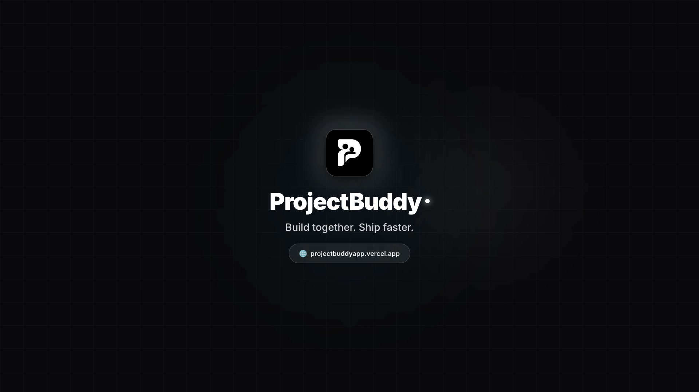
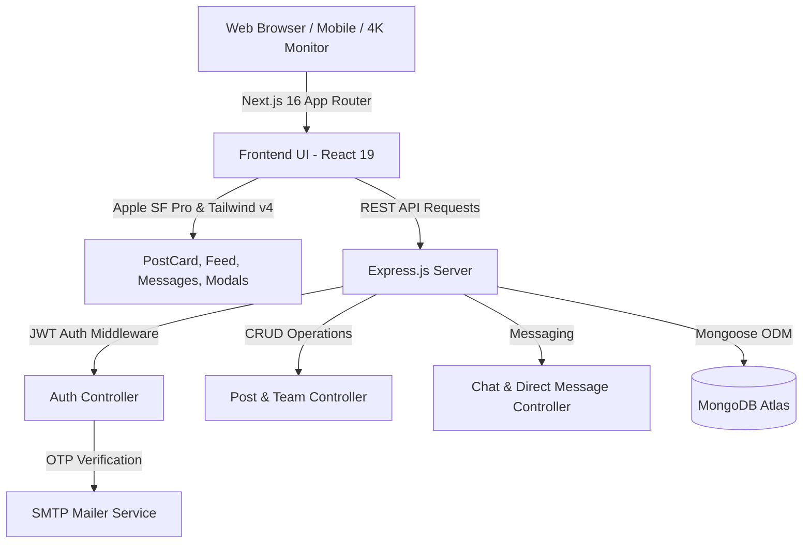

<div align="center">

  

  # ProjectBuddy
  ### *Stop coding in the dark. Build together. Ship faster.*

  <p align="center">
    <strong>The premier developer network to discover trending open-source projects, recruit co-founders, match tech stacks, and ship real-world software in real time.</strong>
  </p>

  <!-- Badges Grid -->
  <p align="center">
    <a href="https://projectbuddyapp.vercel.app">
      
    </a>
    <a href="https://nextjs.org/">
      
    </a>
    <a href="https://react.dev/">
      
    </a>
    <a href="https://tailwindcss.com/">
      
    </a>
  </p>
  <p align="center">
    <a href="https://nodejs.org/">
      
    </a>
    <a href="https://www.mongodb.com/">
      
    </a>
    <a href="https://developer.apple.com/fonts/">
      
    </a>
    
  </p>

  <p align="center">
    <a href="#-watch-launch-film">🎬 Watch Launch Film</a> •
    <a href="#-the-problem-vs-the-solution">💡 Why ProjectBuddy?</a> •
    <a href="#-key-features">⚡ Features</a> •
    <a href="#-architecture--tech-stack">🏗 Architecture</a> •
    <a href="#-getting-started">🚀 Quick Start</a> •
    <a href="#-api-reference">📡 API</a>
  </p>

</div>

---

## 🎬 Watch Launch Film

> *"Every great developer has brilliant side projects that died in isolation. ProjectBuddy turns solo hacking into real-time team momentum."*

<div align="center">

  <a href="https://projectbuddyapp.vercel.app/brag/brag.mp4" target="_blank" title="Click to watch ProjectBuddy Launch Film in 1080p">
    
  </a>

  <br />

  <p>
    ▶️ <strong><a href="https://projectbuddyapp.vercel.app/brag/brag.mp4">Click Here to Play the Full 1080p Launch Film</a></strong> <em>(Opens in browser with soundtrack)</em><br />
    <sub>Local file available at <code><a href="brag-output/brag.mp4">brag-output/brag.mp4</a></code> • Produced with Hyperframes</sub>
  </p>

</div>

### 🎞️ What’s Inside the Film:
1. **The Hook (0:00 - 0:03):** The universal developer dilemma: *"Still coding alone?"*
2. **Project Discovery (0:03 - 0:08):** High-synergy open-source card reveal with required tech roles & team capacity.
3. **The Instant Action (0:08 - 0:12):** Tactile one-click *"Request to Join Team"* submission.
4. **The Collaboration Payoff (0:12 - 0:16):** Live acceptance notification & team chat transition with double-check read receipts.
5. **The Punchline (0:16 - 0:19):** *"Build together. Ship faster."*

---

## 💡 The Problem vs. The Solution

<div align="center">

| The Solo Hacking Struggle ❌ | The ProjectBuddy Experience 🚀 |
|---|---|
| **Endless Solitude:** Building ambitious ideas alone leads to burnout and abandoned GitHub repos. | **Instant Momentum:** Form teams around curated ideas with verified contributors who share your passion. |
| **Mismatched Skills:** Struggling with frontend CSS when you're a backend/AI engineer (or vice-versa). | **Synergy Matching:** Intelligent stack alignment matches Python/Rust experts with Next.js/Tailwind artists. |
| **No Structured Collaboration:** Chaotic Discord DMs, dead Slack groups, and ignored pull requests. | **Dedicated Dev Feed:** Native team slots (`2/4 devs`), join approvals, live DMs, and code showcases. |
| **Generic SaaS Design:** Cluttered, bloated social networks with ads, tracking, and slow web fonts. | **Apple SF Pro Aesthetic:** Pitch-black OLED mode, ultra-clean typography, and responsive scaling from mobile to 4K. |

</div>

---

## ⚡ Key Features

### 1. 🔍 High-Synergy Project Discovery
- Discover open-source projects across **AI/Machine Learning**, **Web3 & Blockchain**, **Fullstack Web**, **Mobile**, and **DevOps**.
- **Stack Synergy Score:** Calculates a percentage match based on your profile skills against project requirements (e.g. *94% Synergy*).
- Filter by *Actively Recruiting Slots*, *Trending / Most Liked*, or *High Synergy*.

### 2. 👥 Team Recruitment Engine
- Creators publish projects with explicit role vacancies (`Fullstack Engineer`, `UI/UX Designer`, `Smart Contract Dev`).
- Live team capacity indicators (e.g., `Team: 2 / 4 members`).
- **One-Click Applications:** Developers submit personalized join pitches with their role and GitHub profile.
- Team leads receive instant Activity Alerts with **Accept** or **Reject** actions.

### 3. 💻 Conditional Code Showcases
- Share technical code snippets with syntax highlighting, language badges, and one-click copy buttons.
- **Smart Display Guard:** Code snippet boxes only render when actual code is present, keeping discussion posts clean and uncluttered.

### 4. 💬 Real-Time Developer Direct Messaging
- Twitter/X-inspired message hub with conversation search, unread badge counters, and online presence.
- Share code snippets inline inside chat bubbles with instant syntax highlighting.
- Double-blue read receipts (`✓✓`) and emoji reactions.

### 5. 🌓 Dual Visual Aesthetic & Apple SF Pro Typography
- **Monochrome Dark Mode (Charcoal):** Smooth zinc undertones with high-contrast borders.
- **Pitch-Black OLED Mode:** True `#000000` background optimized for OLED displays and battery efficiency.
- **Apple SF Pro Typography:** Self-hosted native `woff2` font files with subpixel antialiasing and authentic Apple negative tracking (`letter-spacing: -0.012em`).

### 6. 🖥️ Big Screen & Ultra-Wide Responsiveness
- Centered layout architecture that scales gracefully on **1080p**, **1440p**, and **4K ultra-wide monitors**.
- Constrained feed reading widths to prevent text lines from stretching thousands of pixels.
- 3-column project and developer cards on `2xl` screens.

### 7. 📈 Google Position #1 SEO Optimization
- Comprehensive **Schema.org JSON-LD** structured data (`WebSite`, `SoftwareApplication`, `FAQPage`, `Organization`, `SiteNavigationElement`).
- Crawlable semantic `<h1>` structure, rich meta descriptions, and Google Sitelinks integration.
- Dedicated `robots.ts` and dynamic `sitemap.ts` with daily refresh frequency.

---

## 🏗 Architecture & Tech Stack



### Detailed Stack Breakdown:
- **Client:** Next.js 16 (Turbopack), React 19, Tailwind CSS v4, Lucide Icons, clsx, tailwind-merge.
- **Server:** Node.js, Express.js (ES Modules), Mongoose, JSON Web Tokens (JWT), bcryptjs.
- **Database:** MongoDB Atlas (Cloud Database).
- **Communication:** Nodemailer with SMTP transport for OTP verification.
- **Deployment:** Vercel (Frontend Client) + Render / Cloud Server (Backend API).

---

## 🚀 Getting Started

Run ProjectBuddy on your local machine in under 3 minutes:

### Prerequisites
- [Node.js](https://nodejs.org/) `>= 18.0.0`
- [npm](https://www.npmjs.com/) or [pnpm](https://pnpm.io/)
- A free [MongoDB Atlas](https://www.mongodb.com/cloud/atlas) cluster or local MongoDB instance

---

### Step 1: Clone the Repository
```bash
git clone https://github.com/Pranjal-ux/ProjectBuddy.git
cd ProjectBuddy
```

---

### Step 2: Set Up Backend Server
```bash
cd backend
npm install
```

Create a `.env` file in the `backend/` directory:
```env
PORT=5000
MONGO_URI=mongodb+srv://<username>:<password>@cluster0.mongodb.net/projectbuddy?retryWrites=true&w=majority
JWT_SECRET=super_secure_developer_jwt_secret_key_123!
SMTP_HOST=smtp.gmail.com
SMTP_PORT=587
SMTP_USER=your_email@gmail.com
SMTP_PASS=your_google_app_password
CLIENT_URL=http://localhost:3000
```

Start the backend server:
```bash
npm run dev
# ✅ Backend API live on http://localhost:5000
```

---

### Step 3: Set Up Frontend Client
Open a second terminal window:
```bash
cd frontend
npm install
```

Create a `.env.local` file in the `frontend/` directory:
```env
NEXT_PUBLIC_API_URL=http://localhost:5000/api
NEXT_PUBLIC_APP_URL=http://localhost:3000
```

Start the Next.js development server:
```bash
npm run dev
# ✅ ProjectBuddy live on http://localhost:3000
```

Open [http://localhost:3000](http://localhost:3000) in your browser and start collaborating!

---

## 📡 API Reference

### 🔐 Authentication (`/api/auth`)
| Method | Endpoint | Description |
|---|---|---|
| `POST` | `/api/auth/register` | Register account and dispatch 6-digit OTP code |
| `POST` | `/api/auth/verify-otp` | Verify OTP code and return JWT authentication token |
| `POST` | `/api/auth/resend-otp` | Resend fresh 6-digit verification code |
| `POST` | `/api/auth/login` | Sign in with email/handle and password |

### 📝 Posts & Initiatives (`/api/posts`)
| Method | Endpoint | Description |
|---|---|---|
| `GET` | `/api/posts` | Fetch live feed posts with optional handle/tag filters |
| `POST` | `/api/posts` | Publish a new initiative, team post, or code snippet |
| `POST` | `/api/posts/:id/like` | Toggle like status on a post |
| `POST` | `/api/posts/:id/bookmark` | Toggle bookmark status on a post |
| `POST` | `/api/posts/:id/comment` | Add comment to an existing project post |

### 🤝 Teams & Applications (`/api/join-requests`)
| Method | Endpoint | Description |
|---|---|---|
| `POST` | `/api/join-requests` | Submit application pitch to join an open project team |
| `GET` | `/api/join-requests/pending`| Retrieve pending requests for author's projects |
| `POST` | `/api/join-requests/:id/respond`| Accept or reject a developer join application |

### 💬 Messaging & Notifications (`/api/chats`, `/api/activities`)
| Method | Endpoint | Description |
|---|---|---|
| `GET` | `/api/chats/:user` | List conversation threads and unread count |
| `POST` | `/api/chats/message` | Send direct message with optional code snippet |
| `GET` | `/api/activities/:user` | Retrieve real-time collaboration alerts and statuses |

---

## 🗺️ Product Roadmap

- [x] **v0.1 Public Beta:** Real-time post feed, team creation, join applications, direct chat, and bookmarks.
- [x] **SEO Overhaul:** Schema.org JSON-LD structured data, Google Sitelinks, OpenGraph & Twitter preview tags.
- [x] **Visual Excellence:** Authentic Apple SF Pro self-hosted typography with OLED/Charcoal visual themes.
- [x] **Large Screen Engine:** 4K, 1440p, and ultra-wide responsive container scaling.
- [ ] **v0.2 Upcoming:** Direct GitHub OAuth 2.0 repository sync (pull open issues directly into team posts).
- [ ] **v0.2 Upcoming:** Real-time voice rooms for sprint planning & pair programming.
- [ ] **v0.3 Upcoming:** Verified Developer NFTs / On-Chain Contribution badges.

---

## 🤝 Contributing

We love contributions! If you have an idea or bug fix:

1. **Fork** the Project
2. **Create your Feature Branch** (`git checkout -b feature/CoolFeature`)
3. **Commit your Changes** (`git commit -m 'feat: Add CoolFeature'`)
4. **Push to the Branch** (`git push origin feature/CoolFeature`)
5. **Open a Pull Request**

---

## 📄 License

Distributed under the **MIT License**. See `LICENSE` for more information.

---

<div align="center">

  **Built with passion by [Pranjal Shukla](https://github.com/Pranjal-ux) & the Open Source Community.**

  [**Launch ProjectBuddy**](https://projectbuddyapp.vercel.app) • [**Report a Bug**](https://github.com/Pranjal-ux/ProjectBuddy/issues) • [**Request a Feature**](https://github.com/Pranjal-ux/ProjectBuddy/issues)

  ⭐ **If you find ProjectBuddy useful, please star the repo on GitHub!** ⭐

</div>
